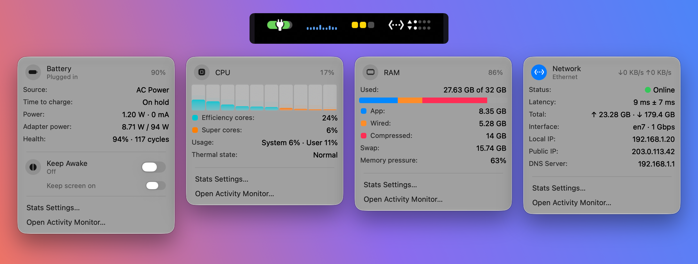

# Stats — summary fork

A fork of [exelban/stats](https://github.com/exelban/stats) that turns the menu bar into a few small, glanceable items with the key details one click away. This page only covers what's different; for everything else, see the [upstream README](https://github.com/exelban/stats#readme).



## What's different

### Summary items in the menu bar
Each module gets its own compact item, and an item disappears when there's nothing to show.

- **Battery** — a charge bar that turns red below 10%, with a bolt while charging and a plug when plugged in but not charging.
- **Keep Awake** — a small split-circle icon next to the battery while it's on.
- **CPU** — load history as bars, colored blue, yellow or red by load.
- **RAM** — three squares for memory pressure (normal, warning, critical).
- **Network** — the Wi‑Fi icon shows real signal strength (or Ethernet, or no connection), plus upload and download activity dots. Each dot means roughly ten times more traffic than the one before.

### Dropdowns
Clicking an item opens a dropdown for just that module, with the key numbers inline:

- **Battery** — source, time to charge or discharge (with the clock time it finishes), power and current, adapter power while plugged in, health and cycles. Also the Keep Awake switch.
- **CPU** — per-core chart, load by core type, system and user load, thermal state (whether macOS is slowing the Mac to keep it cool).
- **RAM** — used of total, a bar split into app, wired and compressed memory, swap (only while in use), memory pressure.
- **Network** — status (online, no internet or disconnected), latency ± jitter, total traffic, interface and link speed, Wi‑Fi generation, security, signal and channel, local and public IP (click to copy), DNS servers.

Rows with nothing known are hidden. Each dropdown links to Stats settings and to Activity Monitor, which opens on the matching tab (Energy, CPU, Memory or Network) if it isn't already running.

### Keep Awake
Stops the Mac from sleeping, like `caffeinate`, until you turn it off. Optionally keeps the screen on too. It always starts off when Stats launches.

### Settings
One page with only what this fork uses:

- Start at login, and keep menu bar item positions
- One update interval for all modules
- On/off switches for Battery, CPU, RAM and Network, each with its own options (keep screen on while awake; Wi‑Fi signal strength; network activity dots)
- Details in dropdowns on or off

### Trimmed
- Only Battery, CPU, RAM and Network are loaded. The other modules (GPU, Disk, Sensors, Bluetooth, Clock, System Stats) and their settings are still in the code, just not loaded or shown, so upstream updates keep merging cleanly.
- The app never checks for or installs upstream releases, since they would replace this build.
- Lower idle CPU use: menu bar items only redraw when what they show changes.

## Building
Open `Stats.xcodeproj` in Xcode and run the `Stats` scheme, or build from the command line:

```bash
xcodebuild -project Stats.xcodeproj -scheme Stats -configuration Release build
```

Xcode may ask you to pick your own signing team. Requires macOS 12 or newer, the same as upstream.

## Staying up to date with upstream
This page lives in `.github/README.md`, which GitHub shows instead of the root `README.md`. The root one stays upstream's, so it never conflicts when merging.

```bash
git remote add upstream https://github.com/exelban/stats.git  # once
git fetch upstream
git merge upstream/master
```

## License
[MIT License](../LICENSE), the same as upstream. Original work by [Serhiy Mytrovtsiy](https://github.com/exelban).
